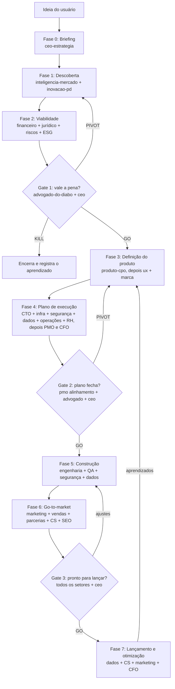

# Empresa de agentes: da ideia ao produto rentável

Este projeto simula uma grande empresa formada por agentes especialistas, um por setor. As ideias passam por todos os setores em uma ordem definida, com portões de decisão, para que só avancem produtos com chance real de serem muito rentáveis e que estejam prontos em todos os aspectos: mercado, finanças, jurídico, produto, tecnologia, marca, vendas e operação.

## Papel do Claude principal: orquestrador

Você (Claude principal) é o **orquestrador**. Subagentes não chamam outros subagentes, então é você quem:

1. Recebe a ideia do usuário e cria a pasta `projetos/<slug>/`.
2. Aciona os agentes de cada fase, **em paralelo** sempre que não houver dependência entre eles (várias chamadas ao Agent na mesma mensagem).
3. Passa a cada agente o `<slug>` do projeto e o que ele precisa ler. Os agentes não se veem: o alinhamento acontece pelos arquivos em `projetos/<slug>/`.
4. Atualiza `STATUS.md` e `DECISOES.md` depois de cada fase (ou pede ao `pmo-projetos`).
5. Não avança de fase com 🟥 aberto, e leva ao usuário as decisões que só ele pode tomar (orçamento, apetite a risco, escolha entre caminhos equivalentes).
6. Ao fim de cada fase, mostra ao usuário um resumo curto: parecer de cada setor, decisão do portão e próximos passos.

## Os agentes (`.claude/agents/`)

### Estratégia e governança
| Agente | Setor | Função no fluxo |
|---|---|---|
| [ceo-estrategia](.claude/agents/ceo-estrategia.md) | Presidência | Cria o briefing, decide nos portões (GO / PIVOT / KILL) e resolve conflitos |
| [advogado-do-diabo](.claude/agents/advogado-do-diabo.md) | Conselho (red team) | Ataca a tese antes de cada portão |
| [pmo-projetos](.claude/agents/pmo-projetos.md) | PMO | Plano, cronograma, RACI, `STATUS.md` e checagem de alinhamento |
| [riscos-auditoria](.claude/agents/riscos-auditoria.md) | Riscos e auditoria | Matriz de riscos e controles |
| [esg-sustentabilidade](.claude/agents/esg-sustentabilidade.md) | ESG | Impacto, acessibilidade, reputação e mercados que exigem ESG |

### Descoberta e viabilidade
| Agente | Setor | Função no fluxo |
|---|---|---|
| [inteligencia-mercado](.claude/agents/inteligencia-mercado.md) | Inteligência de mercado | TAM/SAM/SOM, concorrentes, público e sinais de demanda |
| [inovacao-pd](.claude/agents/inovacao-pd.md) | Inovação e P&D | Variações da ideia, moat, receitas extras e experimentos |
| [financeiro-cfo](.claude/agents/financeiro-cfo.md) | Financeiro | Preço, unit economics, projeções e cenários (**veto**) |
| [juridico-compliance](.claude/agents/juridico-compliance.md) | Jurídico | LGPD, CDC, regulação, PI e contratos (**veto**) |

### Produto e tecnologia
| Agente | Setor | Função no fluxo |
|---|---|---|
| [produto-cpo](.claude/agents/produto-cpo.md) | Produto | PRD, escopo do MVP, roadmap e métricas |
| [ux-design](.claude/agents/ux-design.md) | UX/UI | Fluxos, telas, onboarding e acessibilidade |
| [branding-comunicacao](.claude/agents/branding-comunicacao.md) | Marca e PR | Posicionamento, naming, tom de voz e imprensa |
| [engenharia-cto](.claude/agents/engenharia-cto.md) | Engenharia | Arquitetura, stack, estimativas e implementação |
| [devops-infra](.claude/agents/devops-infra.md) | Infraestrutura | Nuvem, CI/CD, observabilidade e FinOps |
| [seguranca-informacao](.claude/agents/seguranca-informacao.md) | Segurança | Ameaças, requisitos e conformidade (**veto**) |
| [qualidade-qa](.claude/agents/qualidade-qa.md) | Qualidade | Estratégia de testes e prontidão para lançar |
| [dados-analytics](.claude/agents/dados-analytics.md) | Dados e BI | Métricas, tracking, dashboards e testes A/B |

### Mercado, receita e operação
| Agente | Setor | Função no fluxo |
|---|---|---|
| [marketing-growth](.claude/agents/marketing-growth.md) | Marketing e growth | Go-to-market, canais, funil e lançamento |
| [vendas-comercial](.claude/agents/vendas-comercial.md) | Comercial | Processo de vendas, playbook e primeiros clientes |
| [parcerias-negocios](.claude/agents/parcerias-negocios.md) | Parcerias (BD) | Canais de distribuição, alianças e expansão |
| [customer-success](.claude/agents/customer-success.md) | Sucesso do cliente | Onboarding, retenção, expansão e suporte |
| [operacoes-logistica](.claude/agents/operacoes-logistica.md) | Operações (COO) | Processos, fornecedores, entrega e custo por unidade |
| [pessoas-rh](.claude/agents/pessoas-rh.md) | Pessoas | Equipe, contratação, custo de pessoal e cultura |

### Especialistas de apoio (agentes globais do usuário)
| Agente | Quando usar |
|---|---|
| `especialista-marketing` | Naming, copy de landing page, CTAs, anúncios (a pedido de `marketing-growth` ou `branding-comunicacao`) |
| `especialista-seo` | SEO técnico e de conteúdo das páginas públicas (Fase 6) |

## Fluxo da ideia ao produto



### Fase 0: Briefing
- `ceo-estrategia` → `00-briefing.md` (modelo em [templates/briefing-ideia.md](templates/briefing-ideia.md)).
- O orquestrador cria `DECISOES.md` e `STATUS.md` vazios.
- Se faltar informação essencial (orçamento, prazo, público), pergunte ao usuário **uma vez**, com as perguntas agrupadas; o resto vira hipótese.

### Fase 1: Descoberta
1. `inteligencia-mercado` (precisa só do briefing).
2. `inovacao-pd` (lê o estudo de mercado).

### Fase 2: Viabilidade (em paralelo)
`financeiro-cfo`, `juridico-compliance`, `riscos-auditoria`, `esg-sustentabilidade`.

### Gate 1: "Vale a pena?"
1. `advogado-do-diabo` → `advogado-do-diabo-gate-1.md`.
2. `ceo-estrategia` → `gate-1-decisao.md` com GO, PIVOT ou KILL.

Critérios mínimos de GO: evidência de que o público já paga para resolver a dor; LTV/CAC ≥ 3 no cenário base (aceitável ≥ 1,5 com plano para chegar a 3); nenhum 🟥 jurídico; caminho para a primeira receita dentro do prazo do briefing.

### Fase 3: Definição do produto
1. `produto-cpo` → PRD.
2. Em paralelo: `ux-design` e `branding-comunicacao`.

### Fase 4: Plano de execução
1. Em paralelo: `engenharia-cto`, `seguranca-informacao`, `dados-analytics`, `operacoes-logistica`.
2. Em paralelo: `devops-infra`, `pessoas-rh`.
3. `financeiro-cfo` atualiza o modelo com os custos reais (tecnologia, operação, pessoal).
4. `pmo-projetos` → plano, `STATUS.md` e `alinhamento-gate-2.md`.

### Gate 2: "O plano fecha?"
`advogado-do-diabo` → `ceo-estrategia`. O plano precisa caber no orçamento e no prazo, com margem bruta dentro da meta e requisitos de segurança e LGPD atendidos.

### Fase 5: Construção (quando houver algo a construir)
`engenharia-cto` implementa; `qualidade-qa` testa; `seguranca-informacao` revisa; `dados-analytics` valida o tracking. Repita em ciclos curtos até o MVP atender os critérios de aceite.

### Fase 6: Go-to-market (em paralelo)
`marketing-growth`, `vendas-comercial`, `parcerias-negocios`, `customer-success`; `especialista-marketing` para copy e `especialista-seo` para as páginas públicas; `juridico-compliance` revisa termos, privacidade e publicidade.

### Gate 3: "Pronto para lançar?"
Checklist que todo setor precisa aprovar:
- [ ] Fluxos de receita testados e aprovados (`qualidade-qa`)
- [ ] Checklist de segurança assinado (`seguranca-informacao`)
- [ ] Termos de uso, privacidade e publicidade revisados (`juridico-compliance`)
- [ ] Tracking e dashboards funcionando (`dados-analytics`)
- [ ] Preço, cobrança e nota fiscal operando (`financeiro-cfo`, `operacoes-logistica`)
- [ ] Suporte e onboarding prontos (`customer-success`)
- [ ] Plano de lançamento com orçamento por canal (`marketing-growth`)
- [ ] Playbook e metas comerciais (`vendas-comercial`)
- [ ] Monitoramento, backups e plano de incidentes (`devops-infra`)

### Fase 7: Lançamento e otimização contínua
Ciclo recorrente: `dados-analytics` analisa funil e coortes → `customer-success` traz a voz do cliente → `financeiro-cfo` revisa unit economics → `produto-cpo` reprioriza o roadmap → `marketing-growth` realoca verba para os canais com melhor CAC. Aprendizados relevantes voltam para a Fase 3.

## Como os agentes se alinham

- **Fonte única da verdade**: tudo fica em `projetos/<slug>/`. Cada agente lê os arquivos de que depende antes de escrever o seu.
- **Formato padrão de entrega**: Resumo executivo, Análise, Recomendações priorizadas, Números e premissas, Riscos (🟥 bloqueia / 🟨 atenção / 🟩 ok), Handoff e Perguntas em aberto, terminando com `APROVADO`, `APROVADO COM RESSALVAS` ou `BLOQUEADO`.
- **Decisões**: tudo que muda escopo, preço, público ou prazo vai para `DECISOES.md` (data, decisão, alternativas, motivo, dono). Nenhum agente contradiz uma decisão registrada sem apontar o conflito.
- **Conflitos**: o `ceo-estrategia` resolve nesta ordem: legalidade e segurança → lucro esperado ajustado ao risco → tempo até a primeira receita → defensabilidade → experiência do cliente.
- **Vetos**: `financeiro-cfo`, `juridico-compliance` e `seguranca-informacao` podem bloquear. Um veto só cai com plano de mitigação aceito por quem vetou.
- **Números conectados**: o CAC do marketing, o custo por cliente da engenharia, o custo operacional e o custo de pessoal alimentam o modelo do `financeiro-cfo`. Se um número mudar, o CFO recalcula antes do próximo portão.

## Estrutura de pastas

```
ideias-de-projeto/
├── CLAUDE.md
├── .claude/agents/            # 23 agentes de setor
├── templates/
│   └── briefing-ideia.md
└── projetos/
    └── <slug>/
        ├── 00-briefing.md
        ├── DECISOES.md
        ├── STATUS.md
        ├── <nome-do-agente>.md            # um entregável por setor
        ├── advogado-do-diabo-gate-N.md
        ├── alinhamento-gate-N.md
        └── gate-N-decisao.md
```

## Como usar

- **Ideia nova**: "Nova ideia: <descrição>". O orquestrador roda da Fase 0 ao Gate 1 e para para mostrar a decisão.
- **Continuar**: "Seguir para a próxima fase do projeto <slug>".
- **Setor específico**: "Peça ao financeiro-cfo para refazer o preço do projeto <slug>".
- **Modo rápido** (triagem de várias ideias): rode só Fase 0, `inteligencia-mercado`, `financeiro-cfo` e `advogado-do-diabo` para cada ideia e compare em uma tabela de pontuação.

## Regras gerais

- Português do Brasil em todos os documentos.
- Nada de números, clientes, depoimentos ou fontes inventados; toda hipótese é marcada como tal.
- Nada de dark patterns, urgência falsa ou promessa que o produto não cumpre.
- Os agentes aumentam a chance de sucesso, mas não garantem lucro: validar com clientes reais e com profissionais habilitados (advogado, contador) continua obrigatório antes de investir pesado.

---

# Projeto: Mimo Certo (site)

Quiz de presentes com IA, pensado para celular. A pessoa responde até 11 perguntas sobre quem vai ganhar o presente, a IA indica o presente ideal e outras ideias, e cada ideia tem botões de compra com link de afiliado (Amazon e Shopee). O site é **enxuto de propósito**: home com título, texto curto, botão do quiz, os 3 passos e FAQ; rodapé com guias e páginas legais. Não adicionar recursos extras (listas, lembretes, faixas sazonais, rascunho) sem o dono pedir, nem textos de marketing que citem as lojas. Implementa o produto 9 de [ideias/black-friday-top-10-produtos.md](ideias/black-friday-top-10-produtos.md).

## Como rodar
`backend/` e `frontend/` são projetos independentes, cada um com seu `package.json`, `node_modules` e deploy.
- **Backend:** `cd backend`, `npm install`, copie `.env.example` para `.env` e preencha, depois `npm run dev` (porta 3001). Testes: `npm test`.
- **Frontend:** `cd frontend`, `npm install`; o `frontend/.env` define `VITE_API_URL`; depois `npm run dev` (porta 5173).
- Sem `GEMINI_API_KEY`, o backend roda em **modo demonstração** (ideias do acervo próprio, com aviso na tela).
- CI: `.github/workflows/ci.yml` roda os testes do backend, lint e build do frontend e `npm audit` a cada push.
- **Vídeos para o Instagram:** `video/` é um projeto Remotion independente (Reels e capa com a identidade do site). Comandos e mapa dos arquivos em `video/README.md`; roteiro e legenda em `video/ROTEIRO.md`.

## Backend (`backend/src`)
- `app.js` (Express, entrypoint da Vercel) e `local.js` (servidor local). `routes.js`: `/quiz`, `/results/:id` (+ `/report`), `/links` (links de afiliado e produto da Shopee para os guias), `/clicks`, `/events` (funil anônimo), `/health` e `/admin/*` (produtos, `health`, `stats`, `DELETE /admin/results/:id` para pedidos de exclusão).
- `services/generate.js`: IA principal (`GEMINI_MODEL`) → modelo reserva (`GEMINI_FALLBACK_MODEL`) → **acervo próprio** (`demo.js`). A visita nunca termina em erro por falha da IA; o acervo também entra no teto diário (`MAX_AI_CALLS_PER_DAY`) e depois de `MAX_MORE_IDEAS` pedidos de "outras ideias".
- `services/gemini.js`: prompt (respostas entre `<respostas>`, contra injeção), schema da resposta e tempo total limitado (`AI_TIME_BUDGET_MS`).
- `services/result.js`: normaliza e filtra no código (bebida e itens impróprios para menores, o que a pessoa disse que não quer, ofensas) e escolhe o presente ideal dentro do orçamento.
- `services/stores.js`: **única fonte dos links das lojas**. A IA só escolhe o termo de busca; toda ideia ganha um botão por loja de `ACTIVE_STORES` (padrão `amazon,shopee`; Mercado Livre pronto). Tag da Amazon por canal (`AMAZON_TRACKING_IDS`), `{canal}` nos templates. Nunca use URL vinda da IA. `services/shopee.js`: API oficial da Shopee (opcional, com cache e pausa automática se falhar).
- `services/security.js`: limite de requisições compartilhado no MongoDB (funciona em serverless), Turnstile opcional, comparação segura do token de admin. `services/ops.js`: uso diário de IA e alertas por `ALERT_WEBHOOK_URL`.
- **Privacidade:** o nome nunca chega ao servidor (a IA escreve `{nome}`, o navegador troca). Textos livres vão só para a IA. O banco guarda só respostas de lista; resultados expiram em 180 dias (TTL), cliques e eventos em 13 meses, registro de acesso (Marco Civil) em 6 meses. Links usam código aleatório (`publicId`). `npm run migrate:privacy` ajusta dados antigos (rodar uma vez em produção).
- `db.js`: `MONGODB_URI` (Atlas na Vercel); localmente, sobe um MongoDB embutido se não houver servidor.

## Frontend (`frontend/src`)
- `App.tsx` (rotas e telas), `components/` (Landing, Quiz, Result, GiftCard, GuidePage, LegalPageView, AdminPanel em `/painel`), `lib/tracking.ts` (canal de origem por `utm_source`/referrer e eventos anônimos), `lib/personalize.ts` (troca `{nome}`; no link compartilhado o nome vai depois do `#`).
- Páginas legais em `content/legal/` (privacidade, termos, quem somos). **Preencha `content/legal/owner.ts`** (o build avisa enquanto houver colchetes). A frase obrigatória da Amazon fica em `content/stores.ts` e aparece no rodapé.
- Afiliados: passo a passo em [AFILIADOS.md](AFILIADOS.md). Links de afiliado têm `rel="sponsored nofollow"` e aviso de comissão.

## Deploy na Vercel (dois projetos)
- **Backend:** Root Directory `backend`. Obrigatórias: `GEMINI_API_KEY` (projeto com faturamento), `MONGODB_URI`, `CORS_ORIGIN`, `ADMIN_TOKEN`, `AMAZON_ASSOCIATE_TAG` e Shopee (`SHOPEE_APP_ID`/`SHOPEE_APP_SECRET` ou `AFFILIATE_TEMPLATE_SHOPEE`). Recomendadas: `ALERT_WEBHOOK_URL`, `AMAZON_TRACKING_IDS`. Lista completa em `backend/.env.example`.
- **Frontend:** Root Directory `frontend` (preset Vite). Obrigatória: `VITE_API_URL`. Opcionais: `SITE_URL`, `GOOGLE_SITE_VERIFICATION`, `VITE_TURNSTILE_SITE_KEY`. `vercel.json` liga `cleanUrls`, reescreve `/r/:id` para `resultado.html` (noindex) e manda rotas desconhecidas para `404.html`.

## SEO e prévias de link
- `npm run build` pré-renderiza cada página (home, 16 guias, páginas legais, `resultado.html`, `404.html`, `painel.html`) com meta tags, Open Graph e JSON-LD (`src/seo.ts`), além de `sitemap.xml` e `robots.txt`. O navegador só reaproveita o HTML quando o `data-route` do `#root` bate com a URL.
- **Guias** (`src/content/guides/`): cada ideia tem `query` e vira botão de compra (links chegam de `/api/links`). Para criar um guia: arquivo com o tipo `Guide`, import em `index.ts`, linha em `GUIDE_LINKS` (`registry.ts`) e `npm run og`.
- Imagens de prévia (`public/og/*.jpg`) e ícones: `npm run og` (usa o Chrome ou o Edge instalado).
